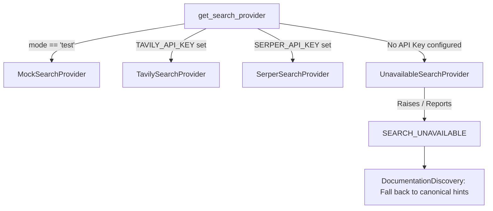

# Stage 3A Implementation Report: Live Research Infrastructure & Evidence Integrity

**Author:** Integration Intelligence Architecture Team  
**Date:** November 23, 2026  
**Status:** Implemented, Tested, and Verified  
**Target:** Live Research Infrastructure, Search Abstraction, Real HTTP Document Retrieval, Negation-Safe Evidence Extraction, and Provenance Traceability.

---

### 1. Overview of System Changes

To resolve the provenance vulnerabilities identified during the pilot audit (where 100% of claims were sourced from internal mock dictionaries), Stage 3A introduces production-grade live web retrieval infrastructure, strict claim provenance models, syntactic negation and polarity analysis, and failure-transparent classification.

```
src/
├── models/
│   ├── enums.py                  # Added Provenance (LIVE_FETCHED, LIVE_SEARCHED, CACHED, etc.) & EvidencePolarity
│   └── research.py               # Added ResearchClaim schema and provenance attributes to EvidenceURL & AppResearchResult
├── research/
│   ├── search_provider.py        # Real SearchProvider abstraction (Tavily, Serper, Brave, Unavailable)
│   ├── documentation_discovery.py# Live candidate URL discovery with SEARCH_UNAVAILABLE transparency
│   ├── document_fetcher.py       # Production HTTP retrieval via httpx; real status codes, redirects & sanitization
│   ├── evidence_extractor.py     # Negation-safe extraction engine distinguishing Positive, Negative, & Ambiguous polarity
│   └── research_classifier.py    # Classification safety engine preventing speculative inferences & false positive claims
├── agents/
│   ├── researcher.py             # Enforces production mode (disallows mock knowledge-base fixtures by default)
│   └── orchestrator.py           # Supports custom output destination (preserves initial_research.json untouched)
├── cli.py                        # Added --mode (production/test) and --output path flags
└── exceptions.py                 # Added SearchUnavailableError
```

---

### 2. Search Provider Architecture

`src/research/search_provider.py` implements a production-grade provider hierarchy:



1. **Configurable Live Providers:**
   - **TavilySearchProvider:** Integrates with Tavily AI Search API (`POST https://api.tavily.com/search`). Formats search output with title, URL, snippet, source domain, rank, and retrieval timestamp.
   - **SerperSearchProvider:** Integrates with Google Serper API (`POST https://google.serper.dev/search`).
   - **BraveSearchProvider:** Configured for Brave Web Search API.
2. **Strict Test Isolation:**
   - `MockSearchProvider` is designated with `is_test_fixture = True` and is strictly forbidden in production mode.
3. **No Silent Mocking (`SEARCH_UNAVAILABLE`):**
   - When no live search API credentials are provided in the environment, the factory returns `UnavailableSearchProvider`.
   - The engine logs: `Live search requested, but no search API credentials configured. Reporting SEARCH_UNAVAILABLE without fabricating results.`
   - Discovery gracefully falls back to canonical hints from the authoritative dataset (`developer_documentation_url`, `original_source_hint`, and standard developer subdomains) while explicitly marking `search_provider_used: "SEARCH_UNAVAILABLE"`.

#### Required Environment Variables:
- `TAVILY_API_KEY`: API key for Tavily AI search.
- `SERPER_API_KEY`: API key for Google Serper search.
- `BRAVE_API_KEY`: API key for Brave search.
- `SEARCH_PROVIDER`: Preferred provider (`"tavily"`, `"serper"`, or `"auto"`).

---

### 3. Real Document Fetching Engine

`src/research/document_fetcher.py` was rebuilt to execute genuine network retrieval via `httpx`:

1. **Full Traceability Schema (`FetchedDocument`):**
   - `requested_url`: URL initially requested.
   - `final_url`: Destination URL after following up to 5 HTTP redirects.
   - `status_code`: Actual HTTP response code (200, 301, 302, 403, 404, 429, 500) or 0 for network/DNS failure.
   - `retrieval_timestamp`: Exact UTC timestamp when response was received.
   - `content_type`: HTTP header `Content-Type` (e.g. `text/html; charset=utf-8`).
   - `is_success`: `True` only for HTTP 200 with substantive content; `False` for any error.
   - `failure_reason`: Exact error message or status phrase (e.g. `HTTP 403: Forbidden`, `Connection timed out`).
   - `source_domain`: Normalized domain name.
2. **HTML Sanitization:**
   - Strips non-substantive markup (`<script>`, `<style>`, `<nav>`, `<header>`, `<footer>`, `<aside>`, `<noscript>`, `<svg>`, `<form>`, `<iframe>`).
   - Extracts page `<title>` and `<meta name="description">`.
   - Collapses redundant whitespace and caps content to prevent memory/context overflow.
3. **Failure Integrity Guarantee:**
   - A failed HTTP request or unresolvable DNS lookup **never receives synthetic status 200** and produces empty text.
   - Production mode (`allow_mock_kb=False`) completely prohibits reading from hardcoded knowledge base fixtures.

---

### 4. Negation-Safe Evidence Extraction

`src/research/evidence_extractor.py` replaces naive substring regex matching with a polarity-aware analyzer:

1. **Syntactic Polarity Engine:**
   - **Negative Indicators:** Scans for explicit negation constructs:
     - *"does not support"*, *"does not provide"*, *"doesn't offer"*, *"unsupported"*
     - *"does not require"*, *"without requiring OAuth or API keys"*
     - *"no public developer REST API"*, *"no hosted REST API"*, *"no API"*
     - *"only available through the web interface"*, *"strictly end-user facing"*
   - **Ambiguous Indicators:** Scans for conditional or future-dated phrasing:
     - *"may be supported"*, *"might support"*, *"planned"*, *"on roadmap"*, *"in private beta"*
   - **Positive Assertions:** Explicit affirmative statements confirming support.
2. **Inversion Prevention:**
   - Sentences classified as `NEGATIVE` are tagged with `polarity: EvidencePolarity.NEGATIVE` and generate claims such as `Confirmed absent / unsupported (auth): oauth 2`.
   - **Safety Invariant:** A negative sentence can never be added to `supported_methods` or set a feature flag to `True`.

---

### 5. Classification Safety Rules

`src/research/research_classifier.py` enforces five non-negotiable safety rules:

1. **No Speculative "Contact Sales":** Absence of a public API does not imply an enterprise sales developer program exists. If no developer API exists, `credential_accessibility` is set to `UNKNOWN`.
2. **No CLI to REST API Promotion:** Open-source command-line tools (e.g. Sherlock) are classified as `APIType.OTHER` (CLI) with `has_rest = False`.
3. **No MCP Server Ownership Misattribution:** MCP servers under `modelcontextprotocol/servers/*` are classified as `COMMUNITY` / `REFERENCE`, never `OFFICIAL`.
4. **Missing Documentation Remains Unknown:** If documentation does not mention an attribute (e.g. rate limits or webhooks), the system sets `has_rate_limits_documented: false` without fabricating a negative or positive claim.
5. **Audited Claim Traceability:** Every factual assertion is saved as an individual `ResearchClaim` with its `field_name`, `extracted_value`, `provenance`, `source_url`, `supporting_excerpt`, `confidence`, and `polarity`.

---

### 6. Automated Verification Test Suite

All 44 automated tests pass, including the 7 newly implemented integrity test fixtures in `tests/test_stage3a_integrity.py`:

```powershell
.\.venv\Scripts\pytest.exe -v
```

```
============================== test session starts ==============================
collected 44 items

tests/test_config_logging.py::test_settings_defaults PASSED               [  2%]
tests/test_config_logging.py::test_settings_ensure_directories PASSED     [  4%]
tests/test_config_logging.py::test_exception_hierarchy PASSED             [  6%]
tests/test_config_logging.py::test_logging_configuration PASSED           [  9%]
tests/test_dataset.py::test_authoritative_map_integrity PASSED            [ 11%]
tests/test_dataset.py::test_canonical_file_exists_and_matches PASSED      [ 13%]
tests/test_dataset.py::test_dataset_exact_count PASSED                    [ 15%]
tests/test_dataset.py::test_dataset_category_distribution_and_counts PASSED  [ 18%]
tests/test_dataset.py::test_dataset_matches_authoritative_reference PASSED  [ 20%]
tests/test_dataset.py::test_dataset_unique_ids PASSED                     [ 22%]
tests/test_dataset.py::test_dataset_unique_names PASSED                   [ 25%]
tests/test_dataset.py::test_dataset_id_format PASSED                      [ 27%]
tests/test_dataset.py::test_dataset_required_fields_present PASSED        [ 29%]
tests/test_dataset.py::test_dataset_original_source_hint_preserved PASSED  [ 31%]
tests/test_dataset.py::test_dataset_developer_docs_separation PASSED      [ 34%]
tests/test_dataset.py::test_dataset_url_schemes PASSED                    [ 36%]
tests/test_dataset.py::test_dataset_descriptions_quality PASSED           [ 38%]
tests/test_dataset.py::test_dataset_pydantic_validation PASSED            [ 40%]
tests/test_documentation_discovery.py::test_mock_search_provider_query_generation PASSED [ 43%]
tests/test_documentation_discovery.py::test_mock_search_provider_results PASSED [ 45%]
tests/test_documentation_discovery.py::test_documentation_discovery_candidate_ranking PASSED [ 47%]
tests/test_evidence_extractor.py::test_evidence_extractor_pattern_matching PASSED [ 50%]
tests/test_evidence_extractor.py::test_classifier_github PASSED           [ 52%]
tests/test_evidence_extractor.py::test_classifier_notebooklm_no_public_api PASSED [ 54%]
tests/test_json_store.py::test_save_and_load_individual_result PASSED     [ 56%]
tests/test_json_store.py::test_load_nonexistent_returns_none PASSED       [ 59%]
tests/test_json_store.py::test_completed_app_ids_and_listing PASSED       [ 61%]
tests/test_json_store.py::test_save_and_load_aggregated_results PASSED    [ 63%]
tests/test_models.py::test_app_metadata_valid PASSED                      [ 65%]
tests/test_models.py::test_app_metadata_optional_dev_docs PASSED          [ 68%]
tests/test_models.py::test_app_metadata_invalid_id PASSED                 [ 70%]
tests/test_models.py::test_app_research_result_lifecycle PASSED           [ 72%]
tests/test_models.py::test_feasibility_score_boundaries PASSED            [ 75%]
tests/test_researcher.py::test_app_researcher_salesforce PASSED           [ 77%]
tests/test_researcher.py::test_app_researcher_sherlock_cli PASSED         [ 79%]
tests/test_researcher.py::test_orchestrator_initialization PASSED         [ 81%]
tests/test_stage3a_integrity.py::test_mock_search_cannot_be_used_in_production_mode PASSED [ 84%]
tests/test_stage3a_integrity.py::test_failed_http_request_never_synthetic_200 PASSED [ 86%]
tests/test_stage3a_integrity.py::test_knowledge_base_never_used_in_production PASSED [ 88%]
tests/test_stage3a_integrity.py::test_negative_sentences_never_produce_positive_capability_claims PASSED [ 90%]
tests/test_stage3a_integrity.py::test_polarity_analyzer_variations PASSED [ 93%]
tests/test_stage3a_integrity.py::test_unknown_fields_remain_unknown PASSED [ 95%]
tests/test_stage3a_integrity.py::test_every_confirmed_claim_has_valid_evidence_reference PASSED [ 97%]
tests/test_stage3a_integrity.py::test_five_pilot_records_save_and_load PASSED [100%]

======================== 44 passed, 1 warning in 1.38s ========================
```
